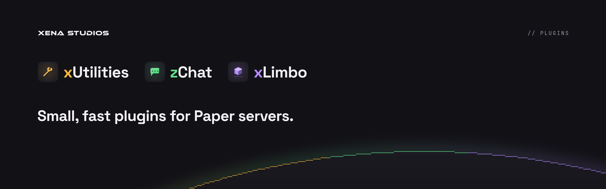

**Small, fast plugins for Paper servers.**

By [Xena Studios](https://xenastudios.co). Each does one job, costs next to nothing to run, and lets you switch off what you don't use. Every setting applies on reload, and old configs carry forward on update.

| | Plugin | | |
|---|---|---|---|
|  | **[xUtilities](xutilities)** | Every command you need. None you don't. | [Docs](https://docs.xenastudios.co/xutilities/) · [Modrinth](https://modrinth.com/plugin/xutilities) |
|  | **[zChat](zchat)** | Format your chat. Keep it clean. | [Docs](https://docs.xenastudios.co/zchat/) · [Modrinth](https://modrinth.com/plugin/zchat) |
|  | **[xLimbo](xlimbo)** | Never drop a player again. | [Docs](https://docs.xenastudios.co/xlimbo/) · [Modrinth](https://modrinth.com/plugin/xlimbo) |

All three need Paper 1.21.11+ and Java 21+. xUtilities and zChat also run on Folia. Get them on [Modrinth](https://modrinth.com/organization/xena-studios); the [docs](https://docs.xenastudios.co) cover setup, commands, permissions and config.

## What's here

| Folder | What it is |
|---|---|
| [`xutilities/`](xutilities), [`zchat/`](zchat), [`xlimbo/`](xlimbo) | The plugins, each with its own README and changelog |
| `core/` | Code every plugin shares, shaded into each jar |
| `build-logic/` | The Gradle convention every plugin applies |
| `sandbox/` | A never-released plugin that tests the core on real servers in CI |
| [`docs/`](docs) | docs.xenastudios.co |
| `scripts/` | Boot tests, changelogs and the new-Minecraft check |

## Building

Needs JDK 21 or newer.

```sh
./gradlew build                  # every plugin, tested, into <plugin>/build/libs/
./gradlew :<plugin>:runServer    # a Paper server with that plugin
```

- [CONTRIBUTING.md](CONTRIBUTING.md): tests, the rules a change keeps, pull requests and releases
- [DECISIONS.md](DECISIONS.md): why the plugins are built the way they are

## Help

- **Bugs and ideas:** [open an issue](https://github.com/xena-studios/plugins/issues/new/choose)
- **Security:** privately, as [SECURITY.md](SECURITY.md) describes
- **Anything else:** [contact@xenastudios.co](mailto:contact@xenastudios.co)

Everyone follows the [code of conduct](https://github.com/xena-studios/.github/blob/main/CODE_OF_CONDUCT.md).

## Licence

[GPL-3.0-only](LICENSE).
