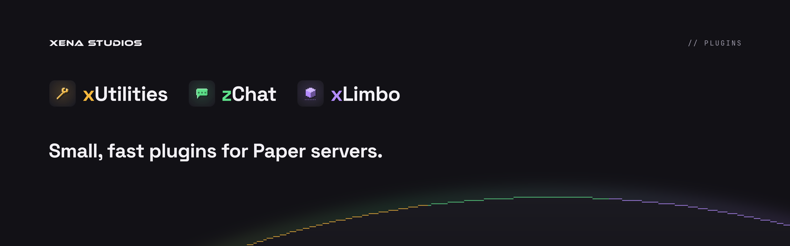

**Small, fast plugins for Paper servers.**

By [Xena Studios](https://xenastudios.co). Each does one job, costs next to nothing to run, and lets you switch off what you don't use. Every setting applies on reload, and old configs carry forward on update.

| | Plugin | | |
|---|---|---|---|
|  | **[xUtilities](xutilities)** | Every command you need. None you don't. | [Docs](https://docs.xenastudios.co/xutilities/) · [Modrinth](https://modrinth.com/plugin/xutilities) |
|  | **[zChat](zchat)** | Format your chat. Keep it clean. | [Docs](https://docs.xenastudios.co/zchat/) · [Modrinth](https://modrinth.com/plugin/zchat) |
|  | **[xLimbo](xlimbo)** | Never drop a player again. | [Docs](https://docs.xenastudios.co/xlimbo/) · [Modrinth](https://modrinth.com/plugin/xlimbo) |
|  | **[xRewind](xrewind)** | Every change, logged. Any of it, undone. | [Docs](https://docs.xenastudios.co/xrewind/) · [Modrinth](https://modrinth.com/plugin/xrewind) |
|  | **[xPlots](xplots)** | Rentable plots, set up in a minute. | [Docs](https://docs.xenastudios.co/xplots/) · [Modrinth](https://modrinth.com/plugin/xplots) |
|  | **[xBans](xbans)** | Bans, mutes and warnings, the LiteBans way. | [Docs](https://docs.xenastudios.co/xbans/) · [Modrinth](https://modrinth.com/plugin/xbans) |

All of them need Paper 1.21.11+ and Java 21+. xUtilities, zChat, xRewind and xBans also run on Folia. Get them on [Modrinth](https://modrinth.com/organization/xena-studios); the [docs](https://docs.xenastudios.co) cover setup, commands, permissions and config.

## Building

Needs JDK 21 or newer.

```sh
./gradlew build                  # every plugin, tested, into <plugin>/build/libs/
./gradlew :<plugin>:runServer    # a Paper server with that plugin
```

## Contributing

Bugs and ideas go in an [issue](https://github.com/xena-studios/plugins/issues/new/choose). Security problems go privately, as [SECURITY.md](SECURITY.md) describes. For anything else, see [SUPPORT.md](SUPPORT.md).

[CONTRIBUTING.md](CONTRIBUTING.md) covers how the repo fits together, tests, the rules a change keeps, pull requests and releases. [DECISIONS.md](DECISIONS.md) explains why the plugins are built the way they are.

## Licence

[GPL-3.0-only](LICENSE).
