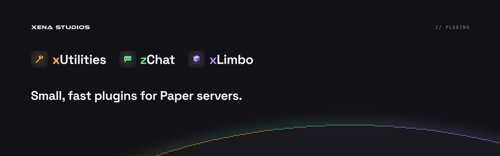

**Small, fast plugins for Paper servers.**

By [Xena Studios](https://xenastudios.co). Each one does one job, costs next to nothing to run, and lets you switch off anything you don't use. Every setting applies on reload, and old configs are carried forward on update.

| | Plugin | | |
|---|---|---|---|
|  | **[xUtilities](xutilities)** | Every command you need. None you don't. | [Docs](https://docs.xenastudios.co/xutilities/) · [Modrinth](https://modrinth.com/plugin/xutilities) |
|  | **[zChat](zchat)** | Format your chat. Keep it clean. | [Docs](https://docs.xenastudios.co/zchat/) · [Modrinth](https://modrinth.com/plugin/zchat) |
|  | **[xLimbo](xlimbo)** | Never drop a player again. | [Docs](https://docs.xenastudios.co/xlimbo/) · [Modrinth](https://modrinth.com/plugin/xlimbo) |

All three run on Paper 1.21.11 and newer with Java 21, and on Folia except xLimbo. Download them from [Modrinth](https://modrinth.com/organization/xena-studios); the [docs](https://docs.xenastudios.co) cover setup, commands, permissions and every config option.

## What's here

```
xutilities/    xUtilities
zchat/         zChat
xlimbo/        xLimbo
core/          code every plugin shares, shaded into each jar
build-logic/   the Gradle convention every plugin applies
sandbox/       a plugin that's never released: boots the core on real servers in CI
docs/          docs.xenastudios.co
scripts/       boot tests, changelogs and the new-Minecraft check
```

Each plugin's folder has its own README and changelog.

## Building

Needs a JDK 21 or newer.

```sh
./gradlew build                  # every plugin, tested, into <plugin>/build/libs/
./gradlew :<plugin>:runServer    # a Paper server with that plugin
```

[CONTRIBUTING.md](CONTRIBUTING.md) has the rest: tests, boot checks, the rules a change keeps, pull requests and releases. [DECISIONS.md](DECISIONS.md) records why the plugins are built the way they are.

## Help

- **Bugs and ideas:** [open an issue](https://github.com/xena-studios/plugins/issues/new/choose).
- **Security problems:** privately, as [SECURITY.md](SECURITY.md) describes.
- **Anything else:** [contact@xenastudios.co](mailto:contact@xenastudios.co).

Everyone taking part follows the [code of conduct](CODE_OF_CONDUCT.md).

## Licence

GPL-3.0. See [LICENSE](LICENSE).
