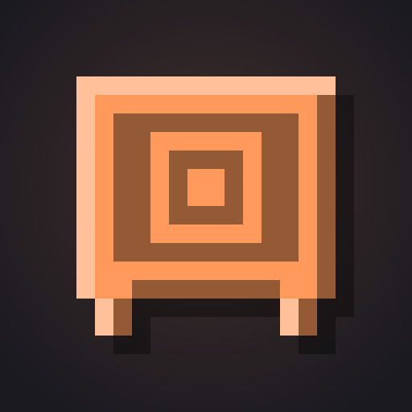

**Small, fast plugins for Paper servers.**

<!-- badges:start: generated by docs/scripts/catalog.ts from the brand repo's docs/badges.md rules. -->
<a href="https://modrinth.com/organization/xena-studios"></a>


<a href="https://plugins.xenastudios.co/"></a>
<!-- badges:end -->

By [Xena Studios](https://xenastudios.co). Each does one job, costs next to nothing to run, and lets you switch off what you don't use. Every setting applies on reload, apart from some plugins' database settings, and old configs carry forward on update.

<!-- catalog:start: the plugins, from the brand catalog. Edit them there, then run pnpm catalog in docs/. -->
**Players**

| | Plugin | | |
|---|---|---|---|
|  | **[xUtilities](xutilities)** | Every command you need. None you don't. | [Docs](https://plugins.xenastudios.co/xutilities/) · [Modrinth](https://modrinth.com/plugin/xutilities) |
|  | **[zChat](zchat)** | Format your chat. Keep it clean. | [Docs](https://plugins.xenastudios.co/zchat/) · [Modrinth](https://modrinth.com/plugin/zchat) |
|  | **[xTeleport](xteleport)** | Every teleport your server needs. | [Docs](https://plugins.xenastudios.co/xteleport/) · [Download](https://plugins.xenastudios.co/xteleport/download/) |
|  | **[xStats](xstats)** | Every player's stats, on your own website. | [Docs](https://plugins.xenastudios.co/xstats/) · [Download](https://plugins.xenastudios.co/xstats/download/) |

**Moderation**

| | Plugin | | |
|---|---|---|---|
|  | **[xRewind](xrewind)** | Every change, logged. Any of it, undone. | [Docs](https://plugins.xenastudios.co/xrewind/) · [Download](https://plugins.xenastudios.co/xrewind/download/) |
|  | **[xBans](xbans)** | Bans, mutes and warnings. Nothing slips through. | [Docs](https://plugins.xenastudios.co/xbans/) · [Download](https://plugins.xenastudios.co/xbans/download/) |

**Economy**

| | Plugin | | |
|---|---|---|---|
|  | **[xPlots](xplots)** | Rentable plots, set up in a minute. | [Docs](https://plugins.xenastudios.co/xplots/) · [Download](https://plugins.xenastudios.co/xplots/download/) |
|  | **[xVote](xvote)** | Votes in. Rewards out. | [Docs](https://plugins.xenastudios.co/xvote/) · [Download](https://plugins.xenastudios.co/xvote/download/) |
|  | **[xMoney](xmoney)** | The economy and Vault, in one plugin. | [Docs](https://plugins.xenastudios.co/xmoney/) · [Download](https://plugins.xenastudios.co/xmoney/download/) |

**Server**

| | Plugin | | |
|---|---|---|---|
|  | **[xLimbo](xlimbo)** | Never drop a player again. | [Docs](https://plugins.xenastudios.co/xlimbo/) · [Modrinth](https://modrinth.com/plugin/xlimbo) |
|  | **[xBackup](xbackup)** | Backups that cost nothing. Restores you can trust. | [Docs](https://plugins.xenastudios.co/xbackup/) · [Download](https://plugins.xenastudios.co/xbackup/download/) |

All eleven need Paper 1.21.11+ and Java 21+. xUtilities, zChat, xRewind, xTeleport, xVote, xBans, xMoney, xStats and xBackup also run on Folia. Download them from [GitHub](https://github.com/xena-studios/plugins/releases), and xUtilities, zChat and xLimbo from [Modrinth](https://modrinth.com/organization/xena-studios) too; the [docs](https://plugins.xenastudios.co) cover setup, commands, permissions and config.
<!-- catalog:end -->

## Building

Needs JDK 21 or newer.

```sh
./gradlew build                  # every plugin, tested, into <plugin>/build/libs/
./gradlew :<plugin>:runServer    # a Paper server with that plugin
```

## Contributing

Bugs and ideas go in an [issue](https://github.com/xena-studios/plugins/issues/new/choose). Security problems go privately, as [SECURITY.md](SECURITY.md) describes. For anything else, see [SUPPORT.md](SUPPORT.md).

[CONTRIBUTING.md](CONTRIBUTING.md) covers how the repo fits together, tests, the rules a change keeps, pull requests and releases. [DECISIONS.md](DECISIONS.md) explains why the plugins are built the way they are, one file per decision in [decisions/](decisions/).

## Licence

[GPL-3.0-only](LICENSE).
