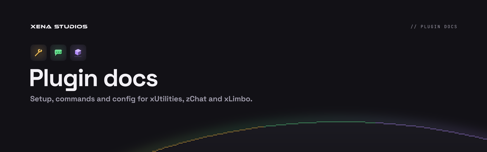

**Setup, commands and config for xUtilities, zChat and xLimbo.**

The source of **[docs.xenastudios.co](https://docs.xenastudios.co)**: a static [Starlight](https://starlight.astro.build) site served by Cloudflare. The docs describe the current releases; a change to a plugin and the pages that describe it go in the same pull request.

## Develop

Needs Node 24.

```sh
npm install
npm run dev          # http://localhost:4321, with hot reload
npm run build        # static site in dist/, with every internal link checked
npm run brand:sync   # copy the brand assets in from a checkout of xena-studios/brand
```

## Layout

```
src/
  content/docs/      the pages, in Markdown: start/ for what the plugins share, one folder per plugin
  generated/         each plugin's default config.yml, written by the plugin's tests (don't edit)
  components/        overrides of Starlight's page title, theme and the horizon
  styles/theme.css   the plugin family's look
  assets/            logos, plugin icons and the horizon, synced from the brand repo
public/
  accents/           each plugin's accent colour, applied to its own pages
  _headers           security headers; the build fills in the CSP's script hashes
  og.png             the link preview
scripts/
  sync-brand.mjs     npm run brand:sync
  headers.mjs        runs after astro build
```

## Writing pages

- Each plugin's **Configuration** page shows its default config from `src/generated/<plugin>/config.yml`. That file comes from the plugin's tests, so it can't drift from the code. After changing a default or a comment in a plugin, run `./gradlew test -PupdateGolden` from the repo root and commit the result.
- Pages are for server owners. Lead with what to do, show the exact config or command, and say what happens when it's wrong.
- Link to other pages with root-relative paths (`/zchat/formats/`). The build fails on a broken internal link.

## Look

The docs wear the plugin family's brand, as Raptor's docs wear Raptor's: deepslate, Space Grotesk, dark only, and each plugin's pages in its own accent with its icon beside the title. Logos, icons, the horizon, the favicon and the link preview are copied from [xena-studios/brand](https://github.com/xena-studios/brand) by `npm run brand:sync`, never redrawn here. The script expects the brand repo next to this one (`../../brand`), or at `BRAND_DIR`. It also refreshes the README banners in `.github/assets/`.

## Deploying

Pushes to `main` that touch `docs/` build, then deploy to Cloudflare from the `docs` environment, which only `main` can use: its `CLOUDFLARE_API_TOKEN` secret goes to the deploy step alone, with the repo's `CLOUDFLARE_ACCOUNT_ID` variable ([`docs.yml`](../.github/workflows/docs.yml)). Pull requests only build.
