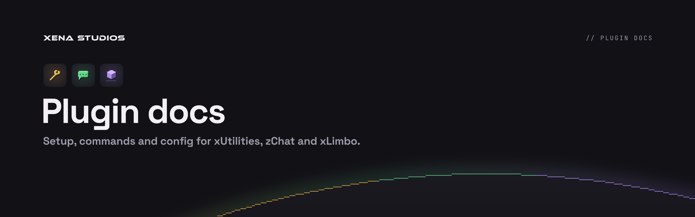

**Setup, commands and config for every Xena Studios plugin.**

The source of **[plugins.xenastudios.co](https://plugins.xenastudios.co)**, a static [Starlight](https://starlight.astro.build) site served by Cloudflare. The docs describe the current releases, so a plugin change and its docs go in the same pull request.

## Develop

Needs Node 24 and pnpm.

```sh
pnpm install
pnpm dev          # http://localhost:4321, with hot reload
pnpm check        # type-check the pages, components and scripts
pnpm build        # check, then build the static site in dist/, with every internal link checked
pnpm brand:sync   # copy the brand assets in from a checkout of xena-studios/brand
pnpm catalog      # rebuild every list of the plugins from the brand catalog
```

`pnpm catalog:check` changes nothing, and fails if a list is out of date. The config and scripts are TypeScript, checked by `astro check`. The scripts run on Node directly, which strips their types.

## Layout

```
src/
  content/docs/      the pages, in Markdown: start/ for what the plugins share, one folder per plugin
  generated/         each plugin's default config.yml, and each rewritten plugin's manifest.json and its schema, written by Gradle (don't edit)
  data/              the brand catalog, the plugin data pnpm catalog reads and writes, versions.json and releases/
  components/        the home inventory, download lists and horizon, and overrides of Starlight's header, sidebar, page title, footer and theme
    reference/       a rewritten plugin's reference, from its manifest (<Reference plugin show />)
    plugin/          a rewritten plugin's install tabs, download picker and version switch
  pages/404.astro    the not-found page, kept out of search engines
  plugins.ts         every plugin with pages, and which major a page describes
  redirects.ts       redirects for an old major's pages when a rewrite ships
  routeData.ts       each page's sidebar and accent
  styles/            the brand's tokens (tokens.css), the family's look (theme.css) and its game GUI (gui.css)
  assets/            logos, plugin icons and the horizon, synced from the brand repo
public/
  accents/           each plugin's accent colour, applied to its own pages (pnpm catalog)
  _headers           security headers; the build fills in the CSP's script hashes
  og.png             the link preview
  robots.txt         lets every crawler in, and points to the sitemap
  .well-known/security.txt   where to report security problems (RFC 9116)
scripts/
  catalog.ts         pnpm catalog
  sync-brand.ts      pnpm brand:sync
  headers.ts         runs after astro build
```

## Writing pages

- Each plugin's **Configuration** page shows its default config from `src/generated/<plugin>/config.yml`. That file comes from the plugin's tests, so it can't drift from the code. After changing a default or a comment in a plugin, run `./gradlew test -PupdateGolden` from the repo root and commit the result.
- Each plugin's **Changelog** and **Download** pages, and the version on its overview, are written by `pnpm catalog`: the changelog from `<plugin>/CHANGELOG.md`, the version from its `build.gradle.kts`. Edit those, not the pages.
- Pages are for server owners. Lead with what to do, show the exact config or command, and say what happens when it's wrong.
- Link to other pages with root-relative paths (`/zchat/formats/`). The build fails on a broken internal link.

## The rewrite's pages

A rewritten plugin's docs are built from its code. Its Gradle build writes `src/generated/<plugin>/manifest.json` (commands, permissions, config, messages, placeholders, events and its platform table); the `references` collection checks it against `src/generated/manifest.schema.json`, so a manifest the site can't read fails the build. `src/content/docs/xsample/` is the template, on the core's sample plugin: hidden (no navigation, search, sitemap or indexing; `src/data/versions.json`) but built, so every component is checked.

- **Pages:** overview, install, download, commands, permissions, configuration, messages, placeholders, integrations, importers, FAQ, developer API, changelog. A reference section is one line, `<Reference plugin="xsample" show="commands" />` (also `platforms`, `permissions`, `config`, `messages`, `placeholders`, `events`), under a short hand-written intro. A section with nothing in it says so instead of showing an empty table.
- **Install:** `<InstallTabs plugin="..." />`, a tab per platform the manifest releases on.
- **Download:** `<DownloadPicker plugin="..." />`, from the manifest's platforms and `src/data/releases/<plugin>.json` (each jar's platforms and Minecraft versions, and the stores that carry it; its shape is in `content.config.ts`). Without JavaScript it's the full list; with it, two menus pick the one jar. A jar for a platform the manifest doesn't release on fails the build.
- **Versions:** when a plugin's rewrite ships, move its current pages into `src/content/docs/<plugin>/v<old major>/` and add it to `src/data/versions.json`. `/<plugin>/` is then the new major; the old one gets a sidebar of its own, a version switch under every title and a note that it's the old major, and each old page the new major doesn't have redirects from its old address (`src/redirects.ts`), so no link breaks. Until then nothing moves.

## Look

The docs use the plugin family's brand: its tokens (`tokens/plugins.css`, copied to `src/styles/tokens.css`), deepslate, Space Grotesk, dark only, and each plugin's pages in its own accent with its icon beside the title. XENA appears only in the footer, as the brand says for a product's own site; the header carries the family's name. Search is Starlight's Pagefind.

Logos, icons, the horizon, the favicon and the link preview come from [xena-studios/brand](https://github.com/xena-studios/brand). Don't redraw them here; run `pnpm brand:sync`. It expects the brand repo at `../../brand` (or set `BRAND_DIR`), and also refreshes the README banners in `.github/assets/` and the brand catalog in `src/data/catalog.json`, so run `pnpm catalog` after it.

## Deploying

Pushes to `main` that touch `docs/`, or a plugin's build files or changelog, build and deploy to Cloudflare ([`docs.yml`](../.github/workflows/docs.yml)). So do every release and a daily run, which keep the download pages current. Pull requests only build.

- The `CLOUDFLARE_API_TOKEN` secret lives in the `docs` environment, which only `main` can use, and only the deploy step gets it.
- **`public/.well-known/security.txt` expires on 2027-11-10.** Move the date a year out before then.
