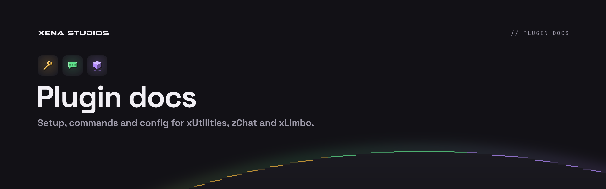

**Setup, commands and config for xUtilities, zChat and xLimbo.**

The source of **[docs.xenastudios.co](https://docs.xenastudios.co)**, a static [Starlight](https://starlight.astro.build) site served by Cloudflare. The docs describe the current releases, so a plugin change and its docs go in the same pull request.

## Develop

Needs Node 24 and pnpm.

```sh
pnpm install
pnpm dev          # http://localhost:4321, with hot reload
pnpm check        # type-check the pages, components and scripts
pnpm build        # check, then build the static site in dist/, with every internal link checked
pnpm brand:sync   # copy the brand assets in from a checkout of xena-studios/brand
```

The config and scripts are TypeScript, checked by `astro check`. The scripts run on Node directly, which strips their types.

## Layout

```
src/
  content/docs/      the pages, in Markdown: start/ for what the plugins share, one folder per plugin
  generated/         each plugin's default config.yml, written by the plugin's tests (don't edit)
  components/        overrides of Starlight's page title, theme and the horizon
  pages/404.astro    the not-found page, kept out of search engines
  styles/theme.css   the plugin family's look
  assets/            logos, plugin icons and the horizon, synced from the brand repo
public/
  accents/           each plugin's accent colour, applied to its own pages
  _headers           security headers; the build fills in the CSP's script hashes
  og.png             the link preview
  robots.txt         lets every crawler in, and points to the sitemap
  .well-known/security.txt   where to report security problems (RFC 9116)
scripts/
  sync-brand.ts      pnpm brand:sync
  headers.ts         runs after astro build
```

## Writing pages

- Each plugin's **Configuration** page shows its default config from `src/generated/<plugin>/config.yml`. That file comes from the plugin's tests, so it can't drift from the code. After changing a default or a comment in a plugin, run `./gradlew test -PupdateGolden` from the repo root and commit the result.
- Pages are for server owners. Lead with what to do, show the exact config or command, and say what happens when it's wrong.
- Link to other pages with root-relative paths (`/zchat/formats/`). The build fails on a broken internal link.

## Look

The docs use the plugin family's brand: deepslate, Space Grotesk, dark only, and each plugin's pages in its own accent with its icon beside the title.

Logos, icons, the horizon, the favicon and the link preview come from [xena-studios/brand](https://github.com/xena-studios/brand). Don't redraw them here; run `pnpm brand:sync`. It expects the brand repo at `../../brand` (or set `BRAND_DIR`), and also refreshes the README banners in `.github/assets/`.

## Deploying

Pushes to `main` that touch `docs/` build and deploy to Cloudflare ([`docs.yml`](../.github/workflows/docs.yml)). Pull requests only build.

- The `CLOUDFLARE_API_TOKEN` secret lives in the `docs` environment, which only `main` can use, and only the deploy step gets it.
- **`public/.well-known/security.txt` expires on 2027-10-22.** Move the date a year out before then.
