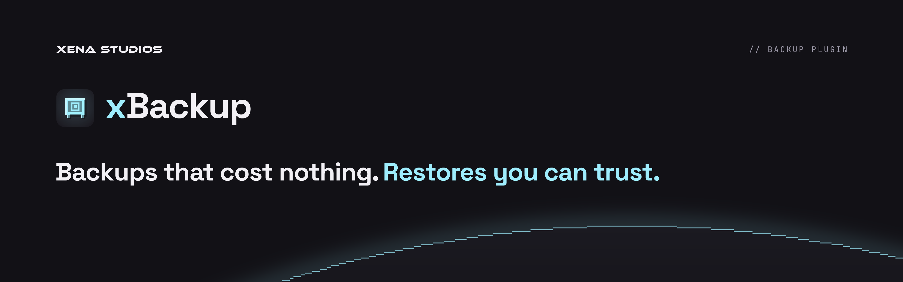

**Backups that cost nothing. Restores you can trust.**

<!-- badges:start: generated by docs/scripts/catalog.ts from the brand repo's docs/badges.md rules. -->
<a href="https://plugins.xenastudios.co/xbackup/download/"></a>


<a href="https://plugins.xenastudios.co/xbackup/"></a>
<!-- badges:end -->

xBackup is incremental backups for Paper and Folia: only what changed since the last backup is stored, down to single chunks, so hourly backups take almost no disk and the server pauses for milliseconds.

- **Every feature free.** No premium version, no early-access builds, nothing behind a Patreon.
- **Only what changed.** Region files are kept chunk by chunk, and everything is stored once, named by its SHA-256, however many backups use it.
- **You won't feel it running.** Autosave off, worlds flushed with `World#save(true)` (per region on Folia), the changes read, autosave back on: 15 to 45 ms on the server's thread in tests on Paper. Hashing, compressing and uploading happen off it.
- **A restore you can trust.** Every file comes back checked against its hash. A dry run first, then it's swapped in on the next start before any world loads, or from the command line with the server stopped.
- **Databases copied safely,** by SQLite itself (`VACUUM INTO`), never as raw bytes.
- **Copies off the server:** a second disk, S3-compatible storage, WebDAV, SFTP, FTP/FTPS, Google Drive, OneDrive and Dropbox. Only new files are sent.
- **Every change applies on reload.** No restarts.

**[Download](https://plugins.xenastudios.co/xbackup/download/)** · [Docs](https://plugins.xenastudios.co/xbackup/) · [Commands](https://plugins.xenastudios.co/xbackup/commands/) · [Restoring](https://plugins.xenastudios.co/xbackup/restoring/) · [Remotes](https://plugins.xenastudios.co/xbackup/remotes/) · [Developer API](https://plugins.xenastudios.co/xbackup/developer-api/) · [Changelog](CHANGELOG.md)

Needs Paper 1.21.11 or newer (or Purpur or Folia) and Java 21 or newer. Nothing else.

## Developing

From the repo root (setup, tests and pull requests are in [CONTRIBUTING.md](../CONTRIBUTING.md)):

```sh
./gradlew :xbackup:build       # compile, test, and check the jar's size budget
./gradlew :xbackup:runServer   # a Paper server with xBackup, in xbackup/run/
```

```
src/main/java/co/xenastudios/xbackup/
  XBackup.java         the plugin: the engine, /backup, the API and the idle listener
  XBackupBootstrap.java  puts a staged restore in place on start, before worlds load
  store/               the repository: packs, index, trees, region layouts, snapshots, verify, GC (pure Java)
  backup/              what a backup reads: the two passes, region files chunk by chunk, SQLite copies
  restore/             finding, dry-running and writing a restore, and the journaled swap
  remote/              S3 (SigV4), WebDAV, the cloud drives and OAuth, copying and fetching
  remote/lib/          SFTP and FTP, loaded with libraries fetched at runtime
  server/              the worker thread, the schedule, the autosave pause on Paper and Folia
  command/             /backup
  cli/                 java -jar xbackup.jar list|restore|verify
api/                   the developer API (co.xenastudios.xbackup:xbackup-api)
boot-checks.txt        console commands CI runs on real Paper and Folia servers
```

The store engine, the backup scanner and restores are pure Java with no server classes, so they're tested without a server: `StoreTest`, `BackupTest` (real-format region files, restores compared byte for byte), `CrashTest` (every operation killed at a random write anywhere in it, 160 rounds), `KillTest` (a second JVM killed with SIGKILL mid-backup), `SwapTest` (the restore swap stopped or failing at every step), `RestoreSafetyTest` (a hostile repository can't write outside the restore), `MirrorTest` (what a copy may delete from a remote) and `AutosaveGateTest` (autosave is never left off).

`RemoteTest` runs every network remote against real servers in Docker when `XB_REMOTES` is set:

```sh
docker run -d -p 19000:9000 -e MINIO_ROOT_USER=xbackup -e MINIO_ROOT_PASSWORD=xbackupsecret cgr.dev/chainguard/minio server /data
docker run -d -p 18080:80 -e AUTH_TYPE=Basic -e USERNAME=xbackup -e PASSWORD=pass bytemark/webdav
docker run -d -p 12222:22 atmoz/sftp xbackup:pass:::upload
docker run -d -p 12121:21 -p 21000-21010:21000-21010 -e "USERS=xbackup|pass" -e ADDRESS=127.0.0.1 \
  -e MIN_PORT=21000 -e MAX_PORT=21010 delfer/alpine-ftp-server
# WebDAV served below the root, as Nextcloud is.
docker run -d -p 18081:8080 rclone/rclone:1.68.2 serve webdav /tmp --addr :8080 \
  --baseurl /remote.php/dav/files/xbackup --user xbackup --pass pass
# FTPS with a self-signed certificate. vsftpd's session reuse check is off: Commons Net can't reuse sessions.
openssl req -x509 -newkey rsa:2048 -nodes -keyout certs/key.pem -out certs/cert.pem -days 30 -subj /CN=xbackup-test.invalid
docker run -d -p 12990:21 -p 21100-21110:21100-21110 -e "USERS=xbackup|pass" -e ADDRESS=127.0.0.1 \
  -e MIN_PORT=21100 -e MAX_PORT=21110 -e "TLS_CERT=/certs/cert.pem -orequire_ssl_reuse=NO" -e TLS_KEY=/certs/key.pem \
  -v "$PWD/certs:/certs:ro" delfer/alpine-ftp-server
XB_REMOTES=1 XB_FTPS_PIN="$(openssl x509 -in certs/cert.pem -noout -fingerprint -sha256 | cut -d= -f2)" ./gradlew :xbackup:test
```

The cloud drives are tested against local stand-ins for their APIs (`CloudDrivesTest`).

The shared core (reloading, config migration, the theme, the update checker, bStats) is in [`core/`](../core).

## Licence

[GPL-3.0-only](../LICENSE), like the rest of the repo.
