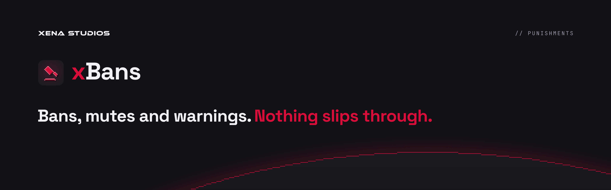

**Bans, mutes and warnings. Nothing slips through.**

<!-- badges:start: generated by docs/scripts/catalog.ts from the brand repo's docs/badges.md rules. -->
<a href="https://plugins.xenastudios.co/xbans/download/"></a>


<a href="https://plugins.xenastudios.co/xbans/"></a>
<!-- badges:end -->

xBans is a free, open-source punishment plugin for Paper and Folia: bans, temporary and IP bans, mutes, warnings and kicks, with history, alts, templates and staff limits, all checked from memory.

- **Every feature free.** No premium version, no early-access builds, nothing behind a Patreon.
- **Bans that hold.** What's in force is in memory before anyone can join, so the join and chat checks never ask the database. Mutes cover chat (on the older chat events too), the listed commands by any alias, signs, books and anvil renames.
- **You won't feel it running.** Writes go through one background thread, history pages are read by key range, and nothing repeats on a single server.
- **Nothing is ever deleted.** An unban is a record beside the ban; only `/prunehistory` deletes.
- **Networks without a proxy plugin.** Servers sharing a MySQL database share bans within seconds.
- **IPs can be hashed**, so alts and IP bans work with no list of addresses to leak.
- **Easy to switch to.** LiteBans' command syntax, so staff habits carry over, and one-command imports from LiteBans, EssentialsX and vanilla.
- **Every change applies on reload**, even switching to another database. No restarts.

**[Download](https://plugins.xenastudios.co/xbans/download/)** · [Docs](https://plugins.xenastudios.co/xbans/) · [Commands](https://plugins.xenastudios.co/xbans/commands/) · [Switching from LiteBans](https://plugins.xenastudios.co/xbans/switching/) · [Developer API](https://plugins.xenastudios.co/xbans/developer-api/) · [Changelog](CHANGELOG.md)

Needs Paper 1.21.11 or newer (or Purpur or Folia) and Java 21 or newer. Uses SQLite out of the box, or MySQL/MariaDB.

## Developing

From the repo root (setup, tests and pull requests are in [CONTRIBUTING.md](../CONTRIBUTING.md)):

```sh
./gradlew :xbans:common:build :xbans:bukkit:build               # tests on the JVM and wasmWasi, the R8 jars and their budgets
./gradlew :xbans:bukkit:runServer                               # a Paper server with the jar, in xbans/bukkit/run/
./gradlew -p core/platform-fabric :xbans:26.3:collect           # the Fabric jar for one Minecraft line, in core/platform-fabric/build/libs/
xbans/bukkit/boot.sh paper 26.3 --java <JDK 25 home>            # the boot checks on a real server (--zchat for the mute seam)
xbans/velocity/network.sh                                       # Velocity in front of two Paper servers on one MariaDB, with real clients
./gradlew :xbans:api:updateKotlinAbi                            # after a deliberate API change
./gradlew :xbans:common:updateXenaManifest                      # after changing a command, setting or message: the docs' reference
```

```
api/             the developer API (XBansApi, XBans.api(), PunishRequest, the staff layer, events), platform-neutral,
                 by uuid
common/          everything xBans does, in Kotlin Multiplatform: the config and its migration from 1.x, the messages
                 (lang/ in its resources), what's in force (model/Active), the punisher, the commands and their
                 LiteBans-style arguments, IP keys and hashing, the store and its 1.x tables (store/), the network
                 (the change feed, and the proxy's fast path); jvmMain opens the database and reads the importers'
                 sources (vanilla, EssentialsX, LiteBans, AdvancedBan) and zChat's mute seam
bukkit/          the Paper, Folia, Spigot and CraftBukkit jar, 1.8.8 on: the join gate, the mute guards (Paper's chat
                 where it exists, modern/), the Bukkit events, and the release of every jar
velocity/, bungee/   the proxies' jars: logins refused before a server, scoped bans at the server switch
fabric/          the Fabric mod, a branch of core/platform-fabric's own build
*-checks.txt, boot.sh, network.sh   what the boot, client and network tests run and expect
CHANGELOG.md     one section per release; the release workflow publishes it
modrinth.md      the Modrinth and Hangar project page, published when it changes on main
```

Every punishment goes through `Punisher`, and nothing on a join or chat waits on the database: what's in force is in memory. The shared core (config, messages, commands, the database and its one writer, the change feed and the proxy channel, the family) is in [`core/`](../core).

## Licence

[GPL-3.0-only](../LICENSE), like the rest of the repo.
