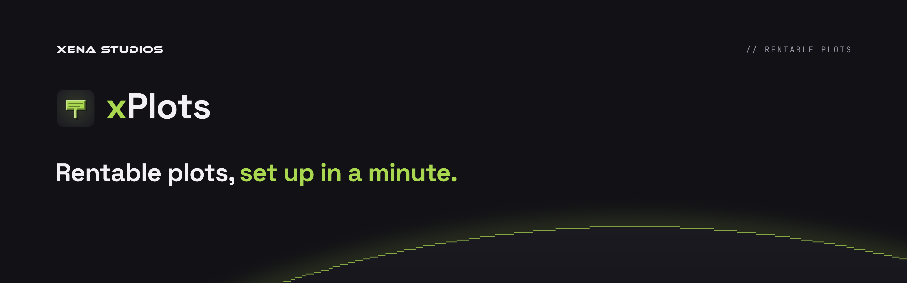

**Rentable plots, set up in a minute.**

xPlots rents small plots to players for in-game money on Paper: select the whole area, say the plot size, confirm, and every plot and its sign is made for you.

- **Setup in a minute.** One selection becomes a grid of plots with paths between them, previewed in particles before anything changes. Signs go up on their own.
- **Plots come back clean.** Each plot is saved when it's made and put back when its rent runs out, a few milliseconds per tick.
- **No region per plot.** xPlots protects its own plots. With WorldGuard installed, it adds one region per field so a world-wide `build deny` doesn't block them.
- **Vault or an item.** Rent is paid through Vault's economy, or with an item such as a box server's Coin.
- **Every feature free.** No premium version, no early-access builds, nothing behind a Patreon.
- **You won't feel it running.** Finding a block's plot is arithmetic on the grid, the same for ten plots or ten thousand. There's one timer for the next lease to end and a once-a-minute check of signs in loaded chunks. Nothing else repeats.
- **Every change applies on reload**, everything but storage. No restarts.

**[Download on Modrinth](https://modrinth.com/plugin/xplots)** · [Docs](https://plugins.xenastudios.co/xplots/) · [Setting up](https://plugins.xenastudios.co/xplots/setting-up/) · [Commands](https://plugins.xenastudios.co/xplots/commands/) · [Changelog](CHANGELOG.md)

Needs Paper 1.21.11 or newer (or Purpur) and Java 21 or newer. Uses SQLite out of the box, or MySQL/MariaDB. Vault, WorldGuard and PlaceholderAPI are optional.

## Developing

From the repo root (setup, tests and pull requests are in [CONTRIBUTING.md](../CONTRIBUTING.md)):

```sh
./gradlew :xplots:build       # compile, test, and check the jar's size budget
./gradlew :xplots:runServer   # a Paper server with xPlots, in xplots/run/
```

```
src/main/java/co/xenastudios/xplots/
  XPlots.java      the plugin: loads plots at startup, and in setup turns on its listeners and commands
  model/           fields, plots and leases in memory, the grid maths, and the index events ask
  storage/         the tables, read once at startup, and the one thread that writes changes in order
  protect/         who may build, open and use what, in plots and on paths
  rent/            renting, paying, members and slots; Vault and item currency; the expiry timer
  reset/           plot snapshots, and putting plots back a few milliseconds per tick
  sign/            plot signs, rewritten only when what they show changes
  setup/           the wand, selections, the particle preview, and making and deleting fields and plots
  menu/            the plot menus
  play/            sign clicks, the wand, joins, and teleport warmups
  hook/            WorldGuard regions and PlaceholderAPI, each loaded only when installed
  command/         /xplots and /plots
boot-checks.txt    console commands CI runs on a real Paper server, and what each must log
CHANGELOG.md       one section per release; the release workflow publishes it
```

The shared core (reloading, config migration, the theme, the update checker, bStats, the database) is in [`core/`](../core).

## Licence

[GPL-3.0-only](../LICENSE), like the rest of the repo.
