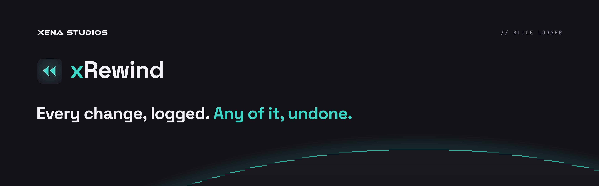

**Every change, logged. Any of it, undone.**

xRewind is a block logger with rollback for Paper and Folia: who placed, broke or took what, where and when, and a way to undo it.

- **Every feature free.** No early-access builds, nothing behind a Patreon.
- **New Minecraft versions the same week.** Paper's API only, no server internals, so an update rarely breaks it.
- **You won't feel it running.** Nothing touches the database on a game thread: changes are queued as a few numbers and written in batches.
- **Easy to switch to.** CoreProtect's command syntax, and its history imported with `/xr import coreprotect`.

**[Download on Modrinth](https://modrinth.com/plugin/xrewind)** · [Docs](https://docs.xenastudios.co/xrewind/) · [Commands](https://docs.xenastudios.co/xrewind/commands/) · [Switching from CoreProtect](https://docs.xenastudios.co/xrewind/switching/) · [Changelog](CHANGELOG.md)

Needs Paper 1.21.11 or newer (or Purpur, or Folia) and Java 21 or newer. Uses SQLite out of the box, or MySQL/MariaDB.

## Developing

From the repo root (setup, tests and pull requests are in [CONTRIBUTING.md](../CONTRIBUTING.md)):

```sh
./gradlew :xrewind:build       # compile, test, and check the jar's size budget
./gradlew :xrewind:runServer   # a Paper server with xRewind, in xrewind/run/
```

```
src/main/java/co/xenastudios/xrewind/
  XRewind.java     the plugin: declares the config and, in setup, the features it turns on
  storage/         the database: its tables, and opening it off the server's threads
  listen/          the listeners, one module per kind of change, each on only when it's logged
  log/             the queue listeners hand changes to, and the one thread that writes them
  query/           lookups, the inspector, and CoreProtect-style parameters
  rollback/        working out a rollback, and applying it a few milliseconds per tick
  maintain/        purges, and the CoreProtect import
  command/         /xrewind's subcommands
```
