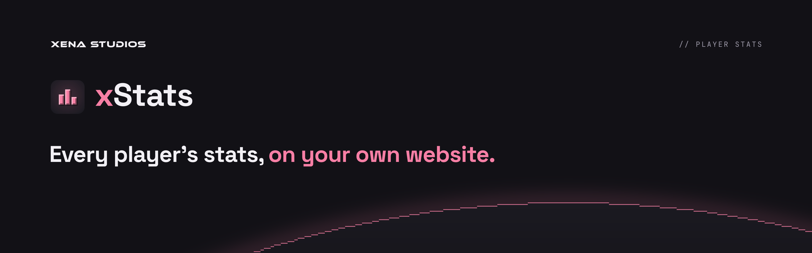

**Every player's stats, on your own website.**

xStats gives players their stats, everyone leaderboards, and owners placeholders and a stats website the server hosts itself, with no web host, account or sign-in.

- **Minecraft's own stats, for free.** Kills, deaths, blocks mined, distance and any other vanilla stat, read from the counters the server already keeps, with no listeners. Plus AFK-aware playtime, sessions, and any PlaceholderAPI value.
- **History from day one.** The first start imports every player's `world/stats` files, off the main thread.
- **Leaderboards per day, week, month and all time,** worked out during the save and answered from memory: `/leaderboard`, `%xstats_top_kills_monthly_1_name%`, Paper text display boards.
- **A stats website, built in.** Search, profiles, leaderboards and totals in the server's own name, logo and colours, on Java's own HTTP server, with a documented JSON API. Or the same site as static files, hosted anywhere.
- **One save task,** reading each player on their own thread, a few a tick. Paper and Folia.

Needs Paper 1.21.11 or newer (or Purpur, or Folia) and Java 21 or newer. Uses SQLite out of the box, or MySQL/MariaDB. PlaceholderAPI is optional.

**[Download on Modrinth](https://modrinth.com/plugin/xstats)** · [Docs](https://docs.xenastudios.co/xstats/) · [The website](https://docs.xenastudios.co/xstats/website/) · [Commands](https://docs.xenastudios.co/xstats/commands/) · [Changelog](CHANGELOG.md)

## Developing

From the repo root (setup, tests and pull requests are in [CONTRIBUTING.md](../CONTRIBUTING.md)):

```sh
./gradlew :xstats:build       # compile, test, check the jar's size budget, and zip the site
./gradlew :xstats:runServer   # a Paper server with xStats and PlaceholderAPI, in xstats/run/
XR_MYSQL=127.0.0.1:3307:xr:root:pw ./gradlew :xstats:test   # the engine's tests on MySQL/MariaDB too
```

```
api/                     the developer API (co.xenastudios:xstats-api), shipped inside the jar
web/                     the website: plain HTML, CSS and JS, copied into the jar and zipped by the build
src/main/java/co/xenastudios/xstats/
  XStats.java            the plugin: opens the database on xStats' thread, and in setup turns on the rest
  stat/                  the stats: the vanilla translation table, definitions from the config, formatting
  collect/               the save task, reading players on their own thread, joins and quits, xStats' thread
  data/                  every player's stats in memory, the save itself, and leaderboards
  storage/               the tables, and every read and write
  importer/              the world/stats import
  command/               /stats, /leaderboard and /xstats
  hook/                  PlaceholderAPI, loaded only when installed
  board/                 leaderboards in the world, as text displays
  profile/               sections other plugins add to profiles
  web/                   the web server, its JSON, rate limits, the self-test and the export
boot-checks.txt          console commands CI runs on real Paper and Folia servers, and what each must log
CHANGELOG.md             one section per release; the release workflow publishes it
```

The shared core (reloading, config migration, the theme, the update checker, bStats, the database, the change feed, chat pages and offline profiles) is in [`core/`](../core).

## Licence

[GPL-3.0-only](../LICENSE), like the rest of the repo.
