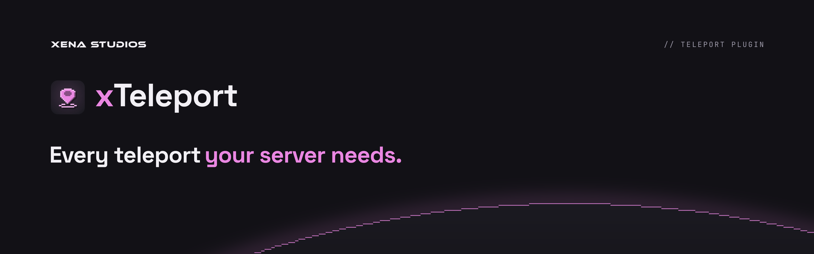

**Every teleport your server needs.**

<!-- badges:start: generated by docs/scripts/catalog.ts from the brand repo's docs/badges.md rules. -->
<a href="https://plugins.xenastudios.co/xteleport/download/"></a>


<a href="https://plugins.xenastudios.co/xteleport/"></a>
<!-- badges:end -->

xTeleport is homes, TPA, warps, spawn and random teleport in one small plugin, for Paper and Folia.

- **Every feature free.** No premium version, no early-access builds, nothing behind a Patreon.
- **The whole set.** `/sethome`, `/home`, `/homes`, `/tpa`, `/tpahere`, `/tpaccept`, `/warp`, `/spawn`, `/rtp`, each one switchable, renamable and with its own permission.
- **Teleports that feel good.** Warmups that moving or damage cancels, on the action bar; cooldowns; Vault costs taken after the warmup and refunded if the teleport fails.
- **No deaths on arrival.** A home or warp now in lava or over the void is refused. The spot is loaded in the background to check it.
- **RTP that doesn't lag.** One candidate chunk at a time, loaded in the background and checked on its own region's thread, with a cap on searches at once and an option for pre-generated worlds.
- **Works with `/back`.** Every teleport uses the command cause, which xUtilities' `/back` records.
- **You won't feel it running.** Nothing repeats, listeners exist only for what's on, and homes are read and saved in the background.
- **Every change applies on reload**, everything but storage. No restarts.
- **Easy to switch to.** EssentialsX's command names, and its homes, warps and spawn imported with `/xteleport import essentials`.

**[Download](https://plugins.xenastudios.co/xteleport/download/)** · [Docs](https://plugins.xenastudios.co/xteleport/) · [Commands](https://plugins.xenastudios.co/xteleport/commands/) · [Switching from EssentialsX](https://plugins.xenastudios.co/xteleport/switching/) · [Developer API](https://plugins.xenastudios.co/xteleport/developer-api/) · [Changelog](CHANGELOG.md)

Needs Paper 1.21.11 or newer (or Purpur or Folia) and Java 21 or newer. Uses SQLite out of the box, or MySQL/MariaDB. Vault and PlaceholderAPI are optional.

## Developing

From the repo root (setup, tests and pull requests are in [CONTRIBUTING.md](../CONTRIBUTING.md)):

```sh
./gradlew :xteleport:common:build :xteleport:bukkit:build      # tests on the JVM and wasmWasi, the R8 jar and its budget
./gradlew :xteleport:bukkit:runServer                          # a Paper server with the jar, in xteleport/bukkit/run/
./gradlew -p core/platform-fabric :xteleport:26.3:collect      # the Fabric jar for one Minecraft line, in core/platform-fabric/build/libs/
xteleport/bukkit/boot.sh paper 26.3 --java <JDK 25 home>       # the boot checks on a real server (--xmoney for the cost test)
./gradlew :xteleport:api:updateKotlinAbi                       # after a deliberate API change
./gradlew :xteleport:common:updateXenaManifest                 # after changing a command, setting or message: the docs' reference
```

```
api/             the developer API (XTeleportApi, XTeleport.api(), TeleportOptions, the add-on seams, events),
                 platform-neutral, by uuid
common/          everything xTeleport does, in Kotlin Multiplatform: the config and its migration from 1.x, the
                 messages (lang/ in its resources), the teleport pipeline and warmups, the safety check and the
                 RTP search (on block kinds the adapter reads), homes, TPA, warps, the store and its 1.x tables,
                 the commands and placeholders; jvmMain opens the database, reads EssentialsX's files and calls
                 xMoney's API
bukkit/          the Paper, Folia, Spigot and CraftBukkit jar, 1.8.8 on: Paper's async chunks and teleports where
                 they exist (modern/), Spigot's chunk queue, Vault costs, PlaceholderAPI and the Bukkit events
fabric/          the Fabric mod, a branch of core/platform-fabric's own build
boot-checks.txt, client-checks.txt, xmoney-*   what the boot tests run and expect (bukkit/, fabric/)
CHANGELOG.md     one section per release; the release workflow publishes it
modrinth.md      the Modrinth and Hangar project page, published when it changes on main
```

Every teleport goes through `teleport/Teleporter`, and nothing in it waits on the disk or a chunk on a server thread. The shared core (config, messages, commands, the database and its one writer, the scheduler, the family) is in [`core/`](../core).

## Licence

[GPL-3.0-only](../LICENSE), like the rest of the repo.
