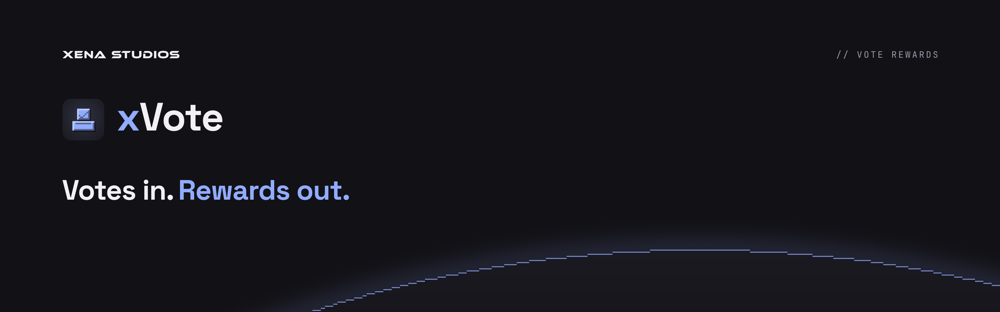

**Votes in. Rewards out.**

<!-- badges:start: generated by docs/scripts/catalog.ts from the brand repo's docs/badges.md rules. -->
<a href="https://plugins.xenastudios.co/xvote/download/"></a>


<a href="https://plugins.xenastudios.co/xvote/"></a>
<!-- badges:end -->

xVote receives votes from server lists and rewards players for them, in one jar for Paper and Folia.

- **Every feature free.** No premium version, no early-access builds, nothing behind a Patreon.
- **A Votifier built in.** v1 and v2, on its own threads, with limits per address, per connection and in total.
- **Every vote paid once.** Every vote is a row; a server takes a vote in the database before paying it, so two servers sharing a database can't both pay it. Offline votes are paid on join.
- **Rewards your way.** Money, items, commands, messages, broadcasts and sounds, on every vote, per site, first of the day, every Nth vote, streaks and totals, plus a vote party.
- **You won't feel it running.** Totals and leaderboards in memory, the database on its own thread, nothing repeating on a single server unless timed reminders are on.
- **Every change applies on reload**, all but storage and network settings. No restarts.
- **Easy to switch to.** NuVotifier's keys and tokens taken over on first start, so no list needs changing, and totals imported from VotingPlugin and SuperbVote.

**[Download](https://plugins.xenastudios.co/xvote/download/)** · [Docs](https://plugins.xenastudios.co/xvote/) · [Setting up](https://plugins.xenastudios.co/xvote/setting-up/) · [Commands](https://plugins.xenastudios.co/xvote/commands/) · [Switching](https://plugins.xenastudios.co/xvote/switching/) · [Developer API](https://plugins.xenastudios.co/xvote/developer-api/) · [Changelog](CHANGELOG.md)

Needs Paper 1.21.11 or newer (or Purpur or Folia) and Java 21 or newer. Uses SQLite out of the box, or MySQL/MariaDB. Vault and PlaceholderAPI are optional.

## Developing

From the repo root (setup, tests and pull requests are in [CONTRIBUTING.md](../CONTRIBUTING.md)):

```sh
./gradlew :xvote:build       # compile, test, and check the jar's size budget
./gradlew :xvote:runServer   # a Paper server with xVote, in xvote/run/
XR_MYSQL=host:port:db:user:password ./gradlew :xvote:test   # also two servers on a real MySQL/MariaDB
```

```
api/                     xvote-api: the developer API, shipped inside the jar
src/main/java/co/xenastudios/xvote/
  XVote.java             the plugin: opens the database and reads every voter at startup, then sets up commands and modules
  receiver/              the Votifier receiver: both protocols, keys, tokens, limits, the NuVotifier import, and a client for /vote test
  vote/                  where every vote goes: matching names, never paying twice, totals and leaderboards in memory
  storage/               the tables, the one database thread, and imports from VotingPlugin and SuperbVote
  reward/                sites, rewards and triggers read from the config, and paying them on the right threads
  play/                  joins, quits and reminders
  hook/                  PlaceholderAPI, loaded only when installed
  command/               /vote and /xvote
boot-checks.txt          console commands CI runs on real Paper and Folia servers, and what each must log
CHANGELOG.md             one section per release; the release workflow publishes it
```

The shared core (reloading, config migration, the theme, the update checker, bStats, the database, the change feed) is in [`core/`](../core).

## Licence

[GPL-3.0-only](../LICENSE), like the rest of the repo.
