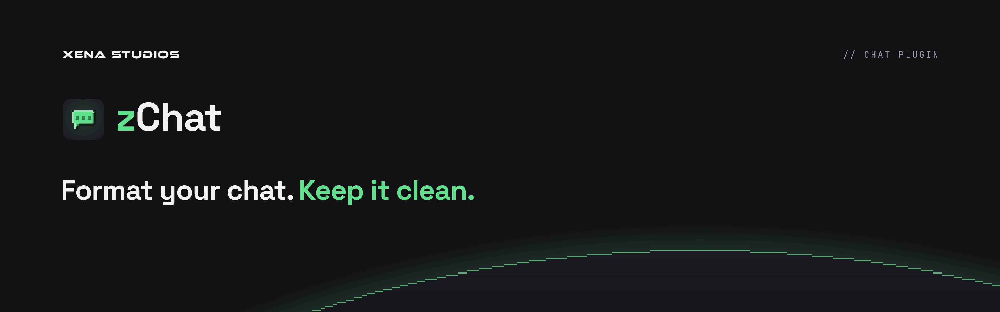

**Format your chat. Keep it clean.**

<!-- badges:start: generated by docs/scripts/catalog.ts from the brand repo's docs/badges.md rules. -->
<a href="https://modrinth.com/plugin/zchat"></a>


<a href="https://plugins.xenastudios.co/zchat/"></a>
<!-- badges:end -->

zChat is a light chat plugin for Paper and Folia: a chat format per rank, a filter that's hard to dodge, a cooldown and anti-spam, mentions, private messages, a chat mute and clearing chat, each one switchable.

- **Every feature free.** No premium version, no early-access builds, nothing behind a Patreon.
- **You won't feel it running.** zChat runs on every chat message, so that path is kept cheap: formats and the filter are compiled when the config loads, the cheapest checks run first, and each message is drawn once, not once per player who sees it.
- **A filter that's hard to dodge.** It catches `s p a c e d` words, `b4dw0rd`, `baaadword` and `bädword`, but leaves innocent words like *class* alone.
- **Players can't inject formatting.** What a player types goes into the format as plain text, unless you give them the colour permission (and even then, only colours and styles).
- **Works with any permissions plugin**, because ranks are picked by permission. PlaceholderAPI is optional.
- **Every change applies on reload**, even turning commands on or off. No restarts.

**[Download on Modrinth](https://modrinth.com/plugin/zchat)** · [Docs](https://plugins.xenastudios.co/zchat/) · [Commands](https://plugins.xenastudios.co/zchat/commands/) · [Developer API](https://plugins.xenastudios.co/zchat/developer-api/) · [Changelog](CHANGELOG.md)

Needs Paper 1.21.11 or newer (or Purpur or Folia) and Java 21 or newer.

## Developing

From the repo root (setup, tests and pull requests are in [CONTRIBUTING.md](../CONTRIBUTING.md)):

```sh
./gradlew :zchat:common:build :zchat:bukkit:build     # tests on the JVM and wasmWasi, the R8 jar and its budget
./gradlew :zchat:bukkit:runServer                     # a Paper server with the jar, in zchat/bukkit/run/
./gradlew -p core/platform-fabric :zchat:26.3:collect # the Fabric jar for one Minecraft line, in core/platform-fabric/build/libs/
zchat/bukkit/boot.sh paper 26.3 --java <JDK 25 home>  # the boot checks on a real server
./gradlew :zchat:api:updateKotlinAbi                  # after a deliberate API change
./gradlew :zchat:common:updateXenaManifest            # after changing a command, setting or message: the docs' reference
```

```
api/        the developer API (ZChatApi, ZChat.api(), mute providers, hidden players, placeholders, chat's events)
common/     everything zChat does, in Kotlin Multiplatform: the config and its migrations from 2.x and 3.x, the
            messages (lang/ in its resources), the filter, formats, mentions, the chat path and the commands;
            jvmMain reads the files on a JVM server
bukkit/     the Paper, Folia, Spigot and CraftBukkit jar: what it does to players, from 1.8.8 on, PlaceholderAPI
            and the Bukkit events
fabric/     the Fabric mod, a branch of core/platform-fabric's own build, one jar per Minecraft line
CHANGELOG.md   one section per release; the release workflow publishes it
modrinth.md    the Modrinth and Hangar project page, published when it changes on main
```

Anything on the chat path runs for every message, so keep it allocation-light and do the work when the config loads instead. The shared core (the chat bridge, config, messages, commands, the family, the platforms) is in [`core/`](../core).

## Licence

[GPL-3.0-only](../LICENSE), like the rest of the repo.
